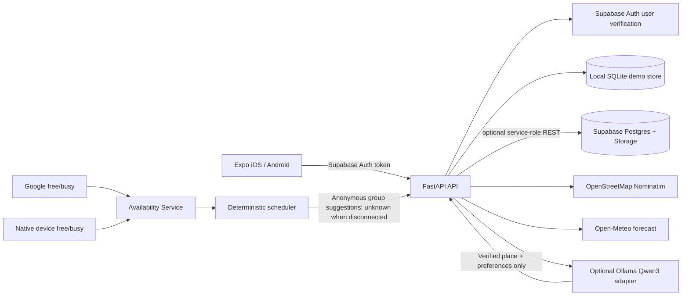

# TouchGrass

**Less scrolling. More living.** A cross-platform social adventure planner for turning “we should hang out sometime” into a real plan.

TouchGrass is an Expo + TypeScript app with a FastAPI service, a local SQLite demo mode, optional Supabase-backed persistence, Google and native device-calendar availability, friend/group invitations, push notifications, and private quest-photo storage. OpenStreetMap place discovery, optional Ollama itinerary generation, and forecast-aware planning round out the hangout flow.

> **Integration status:** these provider flows are implemented but require your own Supabase project, Google OAuth credentials (for Google Calendar), EAS/APNs/FCM configuration (for push), and an iOS/Android development build (for native calendar access). They have not been validated against your provider accounts or a production deployment. The backend uses its Supabase service-role key, which bypasses RLS; keep it server-only and complete deployment hardening and multi-user authorization testing before using real users or private data.

The current Expo/Metro dependency tree still reports upstream moderate/high `npm audit` advisories. The suggested forced fixes require incompatible SDK downgrades, so they were not applied; re-evaluate the Expo toolchain advisories before any production release.

## Run locally

Requirements: Node.js 20+, Python 3.11+, npm, and a network connection for place search. Ollama is optional; without it, a clearly labeled deterministic plan keeps the demo usable.

1. Start the API in a terminal:

   ```powershell
   cd server
   python -m venv .venv
   .\.venv\Scripts\python.exe -m pip install -r requirements.txt
   $env:DEV_MODE = "true"
   $env:DATABASE_PATH = "data/touchgrass.sqlite3"
   .\.venv\Scripts\python.exe -m uvicorn app.main:app --reload --host 0.0.0.0 --no-access-log
   ```

   Without `SUPABASE_URL` and `SUPABASE_SERVICE_ROLE_KEY`, the API seeds a local demo group and stores data in `server/data/touchgrass.sqlite3` (ignored by Git). To use Supabase persistence, configure the backend values in the Supabase section below; keep `DEV_MODE=false`. Check `http://localhost:8000/health`.

2. In a second terminal, install and start Expo from the repository root:

   ```powershell
   npm install
   Copy-Item .env.example .env
   npm start
   ```

   Open the project in Expo Go on iOS/Android, or press `a`/`i` in the Expo terminal. A physical phone must use the computer's LAN IP for `EXPO_PUBLIC_API_URL` in `.env`, not `localhost` (Android emulator: `http://10.0.2.2:8000`). Restart Expo after changing environment values.

3. Optional AI: install Ollama, run `ollama pull qwen3:8b`, and keep the Ollama service reachable from FastAPI. Configure `OLLAMA_BASE_URL` and `OLLAMA_MODEL` in the API environment. The API displays a safe non-AI draft when Ollama is missing or returns invalid output.

## Supabase setup

Create a Supabase project and apply `supabase/migrations/20261011000000_initial_schema.sql`. Set `EXPO_PUBLIC_SUPABASE_URL` and `EXPO_PUBLIC_SUPABASE_ANON_KEY` in the Expo environment. Set `SUPABASE_URL`, `SUPABASE_ANON_KEY`, and `SUPABASE_SERVICE_ROLE_KEY` in the backend environment: the API uses the service role for persistence and must enforce authorization itself. Never expose the service-role key to the mobile app. Allowlist `touchgrass://welcome`, `touchgrass://recover`, and `touchgrass://calendar/complete` as Supabase Auth redirect URLs. Supabase Auth supports sign-up, sign-in, session restore, password-reset requests, and sign-out.

## Calendar, notifications, and media setup

- **Google Calendar:** configure `GOOGLE_CLIENT_ID`, `GOOGLE_CLIENT_SECRET`, `GOOGLE_REDIRECT_URI` (the exact backend callback URL registered with Google), `GOOGLE_OAUTH_STATE_SECRET`, and a valid Fernet `TOKEN_ENCRYPTION_KEY` in the backend. Google access is restricted to free/busy. Device-calendar intervals are held in memory for up to 15 minutes; deploy a single API instance or replace this cache with a suitable shared, short-lived store before scaling.
- **Device calendars:** install an iOS/Android development build; Expo Go does not include the required native calendar configuration. Only event start/end busy periods are synchronized.
- **Push:** set `EXPO_PUBLIC_EAS_PROJECT_ID`, configure EAS project credentials and APNs/FCM, and optionally set the backend `EXPO_PUSH_ACCESS_TOKEN`.
- **Private photos:** enable Supabase Auth and Storage by applying the migration. The `hangout-media` bucket is private; signed image links expire after one hour.

The local API demo identity is enabled only with `DEV_MODE=true`; keep it false outside local development. Supabase service-role operations bypass RLS, so the API authorization checks and migration policies need independent testing. No live provider integration or production deployment has been tested here.

## Project map

```text
app/                       Expo Router screens (Home, Explore, Groups, Profile, planning/review)
components/                Shared mobile UI
lib/                       Theme, auth/session, API client, shared app state and types
server/app/                FastAPI, SQLite/Supabase persistence, calendar/social/notification adapters
server/tests/              Scheduling privacy and planning/API tests
supabase/migrations/       PostgreSQL schema, RLS, private media policies
docs/                      Architecture, privacy, model and demo notes
```

## Architecture



## Privacy, availability, and safety

- A disconnected calendar is **unknown**, never “free.” Availability results do not expose names, raw intervals, event data, or reasons for conflicts. Connected calendars are refreshed before publishing; a detected conflict requires explicit organizer confirmation. Queries are capped per authenticated identity.
- Google refresh tokens are Fernet-encrypted in Supabase and never sent to the mobile app. Native busy intervals are held in a volatile process cache for 15 minutes; they may be unavailable after server restarts or across multiple instances.
- The AI receives only the verified destination and non-sensitive planning preferences, never a calendar record. Provider data is treated as untrusted prompt content; output is shape-checked. Invalid or unavailable model output produces an explicitly identified safe fallback.
- Nominatim supplies place records. Open-Meteo forecasts are limited to the available forecast window; unavailable forecasts are stated, not guessed. Always verify opening/accessibility conditions and local safety before leaving.
- Supabase RLS policies restrict direct client access to profiles, groups, hangouts, RSVPs, quest progress, calendar metadata and private media. Calendar tokens and OAuth nonces have no client policy. The backend service role bypasses RLS, so backend authorization checks are essential. SQLite demo mode has no Supabase RLS and must remain local.
- See [Privacy and safety](docs/PRIVACY.md), [model setup](docs/MODEL.md), [feature status/demo walkthrough](docs/DEMO.md), and [contributing](CONTRIBUTING.md).

## Test and type-check

```powershell
npm run typecheck
cd server
.\.venv\Scripts\python.exe -m pytest
```

No external credentials are required for unit tests. Live OpenStreetMap/Open-Meteo calls, iOS/Android device behavior, and Supabase RLS should be tested in their respective environments before any release.

## License

MIT for this repository. Provider datasets, model checkpoints and dependencies retain their own licenses and attribution terms; see [model and data notes](docs/MODEL.md) and [LICENSE](LICENSE).
